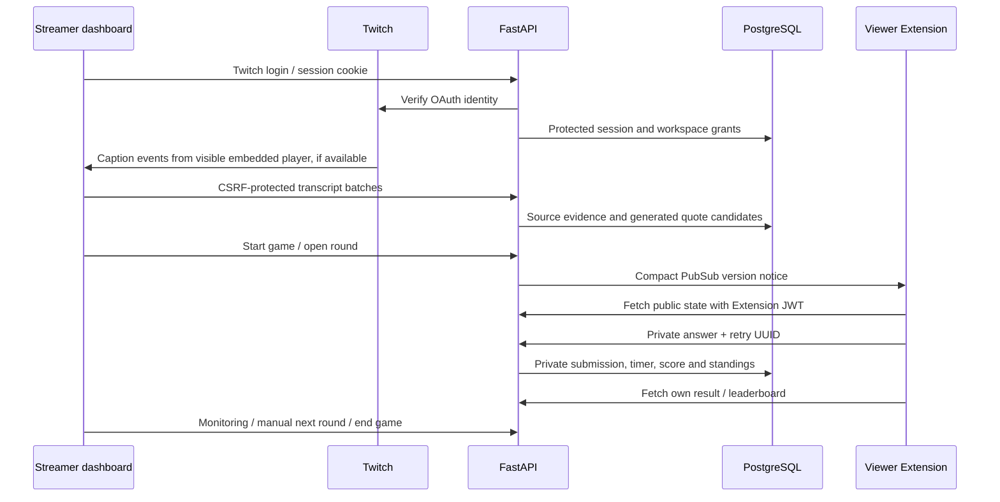

# Connected application

November 2, 2026. Dashboard, viewer, and FastAPI now share the implemented quote-game contract. This integrates quote mode; Niche/Hive Mind and bank/scheduling workflows remain clearly labelled previews. It does not change the backend's confirmed quote rules.

## How the components fit



FastAPI remains authoritative. The dashboard never sends an owner role or calculates scores. Viewers receive no unrevealed canonical answer. No private key or database URI enters a browser bundle.

## Run the connected app

Start the configured backend from `backend/`:

```sh
.venv/bin/python -m uvicorn twitch_games.main:app --host 127.0.0.1 --port 8000 --no-access-log
```

From the repository root:

```sh
npm run dev:app
```

Open `http://localhost:4173/`. The default **Live game** workspace calls the actual backend. Existing planning/bank/team prototype tabs retain a fixture banner and browser-local sample data. The connected workspace has its own real alias and moderator forms.

The development server serves the dashboard and public viewer assets, and proxies `/api/v1/*` to FastAPI. Dashboard requests use same-origin HttpOnly cookies and the CSRF token from `/auth/me`. `API_ORIGIN` is server-only and defaults to `http://127.0.0.1:8000`; `PORT` defaults to 4173. Keep the configured OAuth callback `http://localhost:8000/api/v1/auth/twitch/callback` and dashboard destination `http://localhost:4173/`. Always use `localhost` for the real local app so cookie hosts match.

Sign in, select a verified workspace, and connect its live stream. Play the visible Twitch player with captions enabled. Incoming caption strings enter a bounded queue and are sent serially with original text, observation times and stable retry IDs. The backend generates candidates. Start a quote game and open a round; wait for its 30-second close, then open another round or end the game. No early-close, pause/skip, scheduling or other-mode operation is implied.

Only `settings` may connect/collect, only `live_control` may run games, and only `question_review` may see hidden candidates/aliases. The owner alone manages moderator grants. UI visibility follows current identity; every operation is independently authorized by the backend. Capture stops on workspace changes, logout, permission loss and player-offline events. Reload restores backend game state; it intentionally requires reconnecting the browser caption collector.

## Native Twitch viewer

For Twitch Local Test, run the HTTPS development server separately:

```sh
npm run cert
# Trust the generated localhost CA using the existing setup instructions.
npm run dev
```

It defaults to `https://localhost:4174/`, leaving 4173 free for the OAuth dashboard. Use Testing Base URI `https://localhost:4174/`, Viewer Path `viewer.html`, and Mobile Viewer Path `mobile.html`. **Omit `demo=1`** to use the backend. The HTTPS development server supplies public API configuration and proxies calls to FastAPI. The visible player can also be tested from the HTTPS dashboard at this origin after sign-in; adjust the configured dashboard return destination if using HTTPS as the primary dashboard. Do not bypass certificate warnings.

The native viewer uses the latest `Twitch.ext.onAuthorized` token in `Authorization: Bearer`, requests identity sharing before answering, and sends `{request_id, answer}`. Snapshot fields, private receipts, result points and leaderboards are mapped from the actual snake_case runtime schema. PubSub `{event:'game_state_changed',channel_id,version}` triggers a fresh read. A three-second poll recovers lost messages and reconnects without resetting the input on unchanged state. Edits use new UUIDs; a failed network retry retains the same UUID/raw text. Standings include the viewer's own entry outside the published top list.

For uploaded/hosted Extension assets, set the public HTTPS API base in `public/extension-config.js` and configure allowed backend domains/exact CORS. Production needs public HTTPS API/dashboard hosting with matching callbacks and secure cookies. The localhost proxy is a development convenience, not a public deployment; a physical phone cannot use this machine's `localhost` as its API host.

## Verification actually observed

- 144 Python tests plus 10 subtests against isolated PostgreSQL; 16 Node tests; syntax, Ruff/format and diff checks.
- All 24 backend operations retain successful real HTTP cases.
- The verification suite now executes the actual dashboard API client, caption queue and viewer adapter against real Uvicorn/PostgreSQL. It checks OAuth/cookies/CSRF, verified workspace login, intake, prompt mapping, private submission/edit, a real 30-second window, scoring, restored state, final board and logout.
- Browser UI check: signed in through fixture OAuth; connected a visible fixture player; sent synthetic captions; started/opened a round; one desktop viewer submitted and edited a correct answer, a separate mobile-entry viewer submitted an incorrect one. Both received their own outcome (1 and 0 points), the same board, and final standings after the dashboard ended the game. Reload restored the result. Mobile entry rendered at 390 × 844 without horizontal overflow.
- Twitch provider, caption source and viewer identities in those integration checks are explicit test fixtures. The actual UI/API, database, deadlines and scores run normally. This does not establish real Twitch caption capture, installed Extension PubSub reception, real mobile-device keyboard behavior, Twitch approval or public deployment.

Repeat from `backend/` with `.venv/bin/python scripts/postgres_checks.py` (Docker and Node 22+ required). For disposable browser verification, `.venv/bin/python scripts/browser_stack.py` serves the real app at `http://127.0.0.1:4190/` with clearly labelled test Twitch inputs and a separate Docker database. That harness never loads `.env` or changes production auth. Ctrl-C removes its database/processes. Its helper/player fixture transport is outside the public viewer bundle.

## Current external prerequisites

The configured Supabase direct hostname has an AAAA record but IPv6 TCP currently fails with `EHOSTUNREACH` on this machine. This is a network-path problem before password authentication, not evidence of key rotation. Obtain the **Session pooler** URI from Supabase's Connect dialog for IPv4 connectivity; copy its exact host/username, retain the database password, percent-encode it and keep TLS enabled. No code guesses the pooler hostname. See [Supabase connections](https://supabase.com/docs/guides/database/connecting-to-postgres).

A caption-enabled test stream is still needed for real capture. Twitch captions are conditional; the collector listens for the documented string payload from a visible player. See [Twitch player events](https://dev.twitch.tv/docs/embed/video-and-clips/#javascript-events). Live installed Extension/device verification remains pending. Actual earlier Twitch OAuth/refresh and hosted Supabase checks are recorded separately in `backend/docs/backend-verification.md`.
